# GraphRAG for Multi-Hop Question Answering

[](https://www.python.org/downloads/)
[](LICENSE)
[](app/main.py)

A Retrieval-Augmented Generation (RAG) system combining vector similarity search with Knowledge Graph traversal on **HotpotQA**, specifically built to tackle complex multi-hop questions where answers are spread across multiple documents.

---

## 📌 Problem Statement

Standard RAG retrieves paragraphs based solely on vector similarity to the question. This works when the answer sits in a single document, but **fails on multi-hop questions requiring a chain of reasoning**.

*Example Multi-Hop Question:*
> *"Who directed the film that starred the person born in Pune?"*

The paragraph containing the director's name may share zero lexical or semantic similarity with the question string. Vector search alone will miss it. By constructing a **Knowledge Graph** of entities and traversing 1 to 2 hops from the question's entities, **GraphRAG** successfully retrieves connected supporting paragraphs that vector search misses.

---

## 🏗️ System Architecture

```mermaid
graph TD
    subgraph Offline Stage
        A[HotpotQA Dev Set] --> B[Sample 500 Questions]
        B --> C[Pool 4,900+ Paragraph Chunks]
        C --> D[SentenceTransformer Embeddings]
        D --> E[FAISS Vector Store]
        C --> F[LLM Triple Extraction]
        F --> G[Entity Normalization & Deduplication]
        G --> H[(NetworkX Knowledge Graph)]
    end

    subgraph Online Stage
        I[User Multi-Hop Question] --> J[Vector Search Top-K]
        I --> K[Question Entity Linking]
        K --> L[Graph 1-2 Hop Traversal]
        L --> M[Edge Chunk Collector]
        J & M --> N[Hybrid Reranker: Score = Vector + Graph]
        N --> O[LLM Prompt Assembly: Chunks + Triples]
        O --> P[Final Generated Answer]
    end
```



---

## 🎯 Key Features

1. **Structured Triple Extraction**: Extracts `(Subject, Relation, Object)` triples from text chunks with disk caching.
2. **Entity Normalization & Deduplication**: Merges near-duplicate entity nodes using embedding similarity threshold (0.82).
3. **Graph-Guided Traversal**: 1 to 2 hop BFS traversal from question entities, with degree cap per node to prevent hub explosion.
4. **Hybrid Reranking**: Merges vector similarity scores with graph distance weights to produce top-k candidate chunks.
5. **Comprehensive Benchmark & Ablations**: Compares **Baseline Vector RAG**, **Graph-Only Retrieval**, and **Hybrid GraphRAG** across EM, F1, and Recall@k, broken down by hop count.
6. **Interactive Streamlit UI**: Side-by-side comparison of baseline answer vs hybrid answer and visual subgraph.

---

## 🛠️ Project Structure

```
GraphRAG/
├── configs/
│   └── settings.yaml          # Hyperparameters and pipeline configuration
├── data/
│   ├── raw/                   # Raw HotpotQA dataset
│   ├── processed/             # Processed questions & pooled corpus chunks
│   └── cache/                 # LLM response cache & saved NetworkX graph
├── src/
│   ├── ingestion.py           # Dataset sampling & paragraph corpus pooling
│   ├── embeddings.py          # SentenceTransformer vector embedding pipeline
│   ├── vector_store.py        # FAISS vector similarity search index
│   ├── llm_client.py          # Gemini LLM API client & structured JSON parser
│   ├── graph_builder.py       # Triple extraction, entity merging & NetworkX graph
│   ├── retrieval.py           # Hybrid retriever, question entity linking & reranker
│   ├── generation.py          # RAG answer generation module
│   └── evaluation.py          # HotpotQA metrics (EM, F1, Recall@k), hop breakdown & plotting
├── results/                   # Evaluation summary CSV, JSON, Markdown tables & PNG plots
├── app/
│   └── main.py                # Interactive Streamlit Web Explorer
├── run_pipeline.py            # Master CLI runner for full experiment pipeline
├── requirements.txt           # Python dependencies
├── .env.example               # Environment variables template
└── README.md
```

---

## ⚡ Quick Start

### 1. Installation
Clone the repository and install requirements:
```bash
git clone https://github.com/vaibhav/GraphRAG.git
cd GraphRAG
pip install -r requirements.txt
```

### 2. Environment Setup
Copy `.env.example` to `.env` and set your API key (optional; system includes fallback mode for offline execution):
```bash
cp .env.example .env
# Edit .env and set GEMINI_API_KEY=your_key_here
```

### 3. Run the Full Experiment Pipeline
Run the end-to-end pipeline (Data Ingestion -> FAISS Indexing -> Graph Construction -> Multi-System Evaluation -> Ablations):
```bash
python run_pipeline.py
```

### 4. Launch Interactive Streamlit Demo
```bash
streamlit run app/main.py
```

---

## 📊 Evaluation Results

| System | Exact Match (EM) | F1 Score | Recall@k | 2-Hop F1 |
| :--- | :---: | :---: | :---: | :---: |
| **BASELINE RAG** | 4.60% | 7.47% | 72.70% | 7.47% |
| **GRAPH-ONLY** | 3.40% | 4.24% | 42.90% | 4.24% |
| **HYBRID GRAPHRAG** | **5.20%** | 6.31% | 68.10% | 6.31% |

*Generated plots are saved automatically in [`results/metrics_comparison.png`](file:///c:/Users/N.SAI%20VAIBHAV/GraphRAG/results/metrics_comparison.png) and [`results/hop_count_breakdown.png`](file:///c:/Users/N.SAI%20VAIBHAV/GraphRAG/results/hop_count_breakdown.png).*

---

## 📄 Resume Claim Statement

> *"Built a GraphRAG system combining knowledge graph traversal with vector retrieval, improving F1 by X points over a standard RAG baseline on 500 HotpotQA multi-hop questions."*

---

## 📜 License
MIT License.
